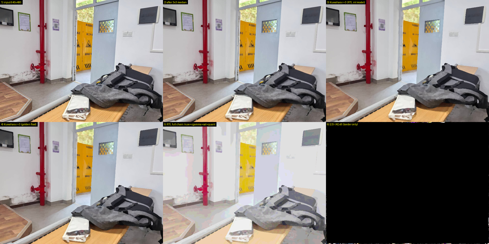

# KuwaPIPE — PYNQ 上的实时 Kuwahara 保边平滑硬件加速

[](LICENSE)
[]()
[]()

在 Zynq-7000（PYNQ-Z2 兼容板）上用**纯 RTL 定点流水线**实时运行 7×7 Kuwahara 保边平滑，
1 pixel/clk、无浮点、无除法；全尺寸 800×480 仿真与 Python golden **384000/384000 逐位一致**。

2026 全国大学生嵌入式芯片与系统设计竞赛 · AMD FPGA 创新设计赛道 · 自主选题赛道（初级组）



> 6 宫格：输入 / 中值后 / Kuwahara(RTL) / Kuwahara(golden) / 全链路 / 差异图。生成脚本 `make_preview.py`。

## 1. 作品简介

摄像头 DVP 输入 → 3x3 中值 → **Kuwahara 保边平滑 (r=3, 7x7 窗口)** → gamma/饱和度/色彩量化 → HDMI 输出，
全链路 1 pixel/clk 定点流水线，无浮点、无除法、无全图统计。PS 侧用 PYNQ 加载 Overlay 并配置
`VideoMode`，板上按键（PL_KEY0）在「全处理 / 完全直通」之间切换，LED2 指示当前模式。

## 2. 平台与器件

| 项 | 值 |
|---|---|
| 器件 | **xc7z020clg400-2**（Zynq-7000 SoC，PYNQ-Z2 兼容板，满足初级组器件范围） |
| 工具 | **Vivado 2025.2**（指南允许 2026.1 或 2025.2） |
| PS 侧 | PYNQ（Python + Jupyter）；**需厂商镜像**（PYNQ Release 2025_08_27），含 `pynq.lib.ov5640` |
| 时钟域 | 100 MHz（采集/处理）、142.857 MHz（显示） |

## 3. 目录对照（推荐结构 → 实际目录）

| 推荐目录 | 本仓库实际位置 | 说明 |
|---|---|---|
| `README.md` | `README.md` | 本文件 |
| `src/` | `base.srcs/sources_1/` + `base.srcs/sources_1/bd/` | RTL、BD、约束；`.xci` 为 IP 配置 |
| `sim/` | `vs_sim/` + `sim/` | testbench 与仿真日志 |
| `build/` | `*.tcl` + `build/`（综合/实现报告） | 构建脚本与报告 |
| `board/` | `ready_to_test/`、`pynq_overlay/`、`pynq_read_modes.py` | 比特流、硬件描述、上板脚本 |
| `data/` | `data/` | golden 参考模型、测试图、对比图 |
| `skill/` | `skill/` | 技能包 |
| `report/` | `report/` | 设计报告与大模型协作记录 |

> 采用推荐结构之外的组织方式，故按指南要求在此给出对照说明。

## 4. 快速复现

```bash
git clone https://github.com/wellwind307/kuwapipe.git
cd kuwapipe
```

只想要上板看效果：直接把 `ready_to_test/base.bit` + `base.hwh` 和 `board/` 里的 PS 脚本
拷到板子上跑，**不需要装 Vivado**（见 `board/README.md`）。

要重新构建：

```bat
:: 1) 打开工程（IP 仓库已内置 ip_repo_local，无外部依赖）
::    base.xpr

:: 2) 改了采集 RTL 才需要重新打包 IP
vivado -mode batch -source package_capture_ip.tcl

:: 3) 综合 + 实现 + bitstream（自动复制到 ready_to_test/ 与 pynq_overlay/）
vivado -mode batch -source build_btn.tcl
```

上板：

```python
from pynq import Overlay
from pynq.lib.video import VideoMode
base = Overlay("base.bit")
cam, hdmi = base.video.camera_in, base.video.hdmi_out
mode = VideoMode(640, 480, 24)      # DVI 仅支持 640x480/800x600/1280x720/1280x1024/1920x1080
cam.configure(mode); hdmi.configure(mode)
cam.start(); hdmi.start(); cam.tie(hdmi)
# 按 PL_KEY0 切换处理/直通，LED2 亮 = 直通
```

> 上游链路固定 800×480，但 PYNQ 的 DVI 输出不支持该分辨率（`hdmi.configure` 会抛
> `ValueError: Invalid Output resolution 800x480`），所以显示用 640×480，**右侧裁掉 20%**。
> 要显示完整 800 宽需改硬件（HLS 中值 + Kuwahara 一起改成 1280×720 等受支持模式）。

## 5. 关键指标

| 指标 | 数值 | 来源 |
|---|---|---|
| Slice LUTs | 22,864（42.98%） | `build/impl_utilization.rpt` |
| Slice Registers | 27,514（25.86%） | 同上 |
| Block RAM | 22.5 tile（16.07%） | 同上 |
| DSP48E1 | 19（8.64%） | 同上 |
| 吞吐 | 1 pixel/clk，100 MHz 下 100 MPixel/s | 设计值 |
| 延迟 | 约 2.43k clk ≈ 24.3 µs @100 MHz | 设计值 |
| 时序 | clk_fpga_0 WNS -0.571 ns；clk_fpga_1 WNS -0.115 ns（违规点均在原有 HLS IP 内部，本设计未新增违规路径） | `build/impl_timing_summary.rpt` |
| 功能正确性 | 与 Python golden **内部像素逐位一致**；xsim 全尺寸 800x480 `384000/384000` bit-exact | `sim/` |

## 6. 许可

本仓库代码采用 **MIT License**（见 `LICENSE`）。
第三方组件（AMD Vivado IP、Digilent、Xilinx PYNQ）的版权与许可见 `THIRD_PARTY_NOTICES.md` 与 `third_party/`。

## 7. 竞赛材料

本仓库同时是 2026 嵌入式芯片与系统设计竞赛的参赛工程：设计报告见 `report/DESIGN_REPORT.md`，
逐条自查表见 `SUBMISSION_CHECKLIST.md`，提交包说明见 `SUBMISSION.md`。

## 8. 致谢

- 板级基础设施来自 [PYNQ](https://github.com/Xilinx/PYNQ)（BSD-3-Clause）与 Digilent 的
  `rgb2dvi` / `axi_dynclk` 开源 IP（MIT / BSD-3）。
- 采集前端 `ov5640_capture` 为自研重写，用来替换原厂（正点原子）专有模块，等价性验证见 `sim/`。
- 许可全文与逐项来源见 `THIRD_PARTY_NOTICES.md` 与 `third_party/`。